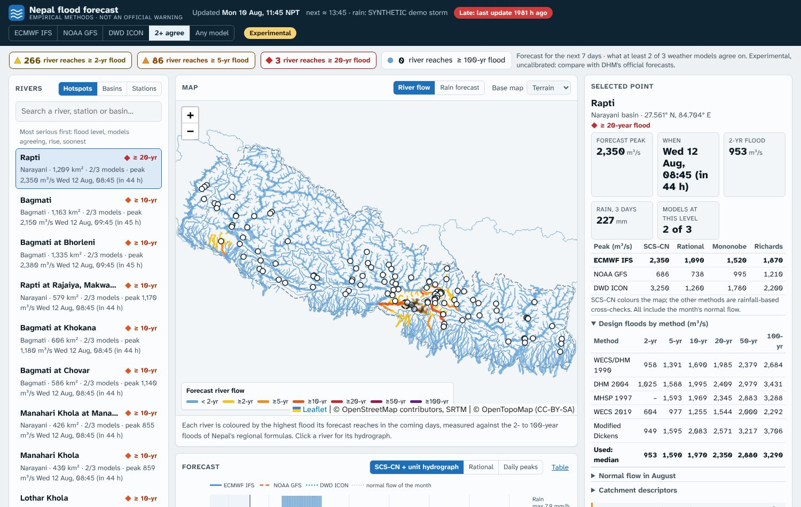
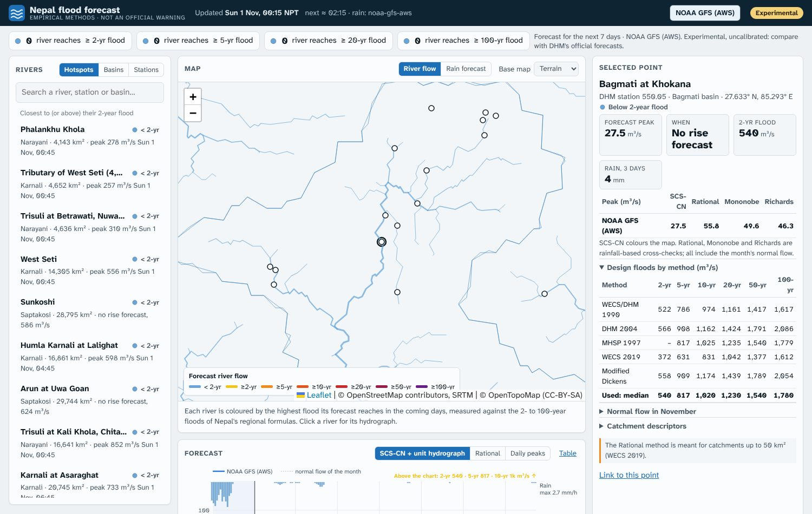

# Nepal empirical flood forecast (experimental)

A live river-flow forecast for **every river of Nepal draining 20 km² or more**
(4,200 river reaches and the 112 DHM hydrometric stations). Every 2 hours it
downloads the hourly rain forecasts of three weather models (ECMWF IFS, NOAA
GFS, DWD ICON) from the free [Open-Meteo](https://open-meteo.com) API, averages
them over the catchment above each river reach, and turns them into discharge
with the **empirical methods used in Nepal** (WECS/DHM, DHM, MHSP and SCS).
The result is an interactive web page: a map of Nepal's rivers coloured by the
flood level their forecast reaches, hydrographs with the 2- to 100-year flood
lines, a rain-forecast map with a 3-hourly animation, and the design floods and
mean monthly flows of every method at every point (interactive charts, or tables).

> [!WARNING]
> **A research test, not a flood warning.** The discharges come from empirical
> formulas and weather-model rain. They have not been checked against measured
> floods at these rivers. Official flood forecasts and warnings in Nepal come from the
> Department of Hydrology and Meteorology ([hydrology.gov.np](https://www.hydrology.gov.np)).



*Above: the page during a **made-up** 200 mm storm over central Nepal, to show the flood
colours. Below: the real forecast of 31 October 2026 (dry season; GFS backup feed).*



## What it does

| | |
|---|---|
| Rivers and basins | Traced from the Copernicus GLO-90 DEM (6″, ~185 m): 4,205 reaches ≥ 20 km² in Nepal, 75 river systems of ≥ 100 km² leaving Nepal. Drainage areas match **105 of 112 DHM stations within 10%** (median difference 0.4%), see [verification](docs/verification.md) |
| Rain | Open-Meteo, hourly, 7 days past and 7 days ahead, on the 0.25° grid (377 nodes, ~4,500 free API calls a day). Backup: NOAA GFS read straight from AWS |
| Discharge (rainfall-based) | SCS curve number + SCS unit hydrograph (main method), Rational method, Mononobe-Rational and B.D. Richards daily peaks, over the normal monthly flow (WECS/DHM 1990) |
| Flood levels (area-based) | 2, 5, 10, 20, 50, 100-year floods of WECS/DHM 1990, DHM 2004, MHSP 1997, WECS 2019 specific discharge and Modified Dickens (median), plus Dickens, Ryves and Inglis as cross-checks |
| Normal flow | Mean monthly flow of WECS/DHM 1990, NEA 1997 and DHM 2004 |
| Catchment descriptors | A, A₃₀₀₀, A₅₀₀₀, mean elevation (DEM); longest flow path and drop → Kirpich t_c; monsoon and annual wetness index (ERA5 2019-2023); runoff coefficient and curve number (ESA WorldCover 2021) |
| Update | every 2 hours, on GitHub's servers (GitHub Actions) or on your own computer |

**Reading the page? Read the [user guide](docs/user-guide.md)**: every part of the page
explained with screenshots, from the five model views to the river panel and the chart.

**Handing over or changing something? Read the [operator guide](docs/operator-guide.md)**:
where the forecast comes from, what to edit for each change (most are one line in
`config.yaml`), how the page ranks rivers, and what to do when something is wrong.

How each formula is used:
[docs/methods.md](docs/methods.md). Every formula is checked against
reference values in `tests/test_formulas.py`.

## Two ways to run it

### A. Entirely on GitHub (no computer needed)

1. **Settings → Pages**: *Deploy from a branch*, branch `gh-pages`, folder `/`.
   (The branch appears after the first run.)
2. **Actions → flood-forecast → Run workflow** once. From then on it runs by itself
   every 2 hours (`.github/workflows/forecast.yml`) and publishes the site to
   `https://<user>.github.io/Nepal_Empirical_Flood_Forecast/`.

The forecast needs only numpy, pandas and pyyaml and takes about a minute, so
GitHub's free runners are plenty. Two caveats: GitHub runs schedules on a
best-effort basis (often 5-20 minutes late), and Open-Meteo limits free use per
IP address, which GitHub's shared runners can reach; the job then uses the GFS
backup, and the page says so. An Open-Meteo API key can be added as the
repository secret `OPEN_METEO_API_KEY`.

### B. On your own computer (Linux or macOS), with GitHub as the backup

```bash
git clone https://github.com/SauravBhattarai19/Nepal_Empirical_Flood_Forecast.git
cd Nepal_Empirical_Flood_Forecast
python3 -m venv .venv && . .venv/bin/activate
pip install -e ".[gfs,test]"
nepal-forecast check          # can Open-Meteo and the GFS backup be reached?
nepal-forecast run            # one update now -> site/
nepal-forecast preview        # open http://localhost:8000
```

Then keep it running:

```bash
nepal-forecast service install   # systemd user service (or cron) running 'nepal-forecast serve'
```

To publish from your computer, set `publish: git: remote:` in `config.yaml`
(or `publish: command:` for your own web server). To keep GitHub Actions as a
backup only, add the repository variable `ONLY_IF_STALE_MIN = 150` (Settings →
Secrets and variables → Actions → Variables): the workflow then runs only when
the published forecast is more than 150 minutes old.

## Commands

```bash
nepal-forecast run [--publish]        # one update
nepal-forecast serve                  # update now and every 2 hours
nepal-forecast status                 # the last update, how many rivers above each flood level
nepal-forecast check                  # test the rain feeds
nepal-forecast preview                # serve site/ on localhost:8000
nepal-forecast prepare [step]         # rebuild the river network (heavy, once; see below)
nepal-forecast service install        # run 'serve' in the background
```

## The static river network (`static/`)

Everything the forecast needs about the rivers is precomputed and committed:

| File | What |
|---|---|
| `static/reaches.geojson` | the 4,205 river reaches of Nepal (id, downstream reach, area, name, basin) |
| `static/targets.csv` | the catchment descriptors of each forecast point (reach outlets and DHM stations) |
| `static/rain_weights.npz`, `rain_nodes.csv` | how much of each catchment is nearest each 0.25° rain node |
| `static/basins.geojson` | the 75 river systems (≥ 100 km²) leaving Nepal |
| `static/climate_era5_2019_2023.npz` | the ERA5 rainfall grid behind MWI and AWI (so a rebuild needs no ERA5 download) |
| `static/stations.csv` | the DHM stations, published vs traced drainage area |
| `static/dhm_stations_2025.csv` | the DHM station list, July 2025 (input) |

It was built with `nepal-forecast prepare` (needs `pip install -e ".[prepare]"`,
about 1 GB of downloads, mostly ERA5, and an hour). All inputs are open data on
AWS with no account: Copernicus GLO-90 DEM, ESA WorldCover 2021, ERA5 (NSF NCAR
copy), and Natural Earth for the border. Re-run it only to change the network:
another minimum river size, extra forecast points (`points:` in `config.yaml`, then
`nepal-forecast prepare network`), or other curve numbers.

## Adding your own points

Points of interest (an intake, a canal crossing, a bridge) go under `points:` in
`config.yaml` with their coordinates and, if known, drainage area; the point is
snapped to the river whose traced area matches.

## Limits (read before using the numbers)

* **Uncalibrated.** The curve numbers assume soil group C; the runoff
  coefficients are set by land cover; Kirpich t_c uses the
  longest flow path. None has been tuned to observed floods yet. The design-storm
  check in [verification](docs/verification.md) shows the rainfall method and the
  flood levels agree in scale, not that either is right.
* **Rain-driven only.** Snow and glacier melt, lake outbursts, landslide dams and
  dam operations are not modelled. For the big Himalayan rivers the empirical
  methods are rough: their floods build over days from far upstream.
* **ERA5 is too wet over the hills** (about 2× at Kathmandu and Jumla), so the
  monthly-flow formulas, i.e. the base flow, run high there; see verification §6.
* **Weather-model rain** at 9-25 km misses the small, intense storms that cause
  flash floods in the Chure. Compare the three models; the "Any model" view shows
  the highest.
* The regional formulas were fitted mostly to large snow-fed and Mid-Hill rivers;
  for small Chure streams they are the weakest part.

## Credits
Rain: [Open-Meteo](https://open-meteo.com) (CC BY 4.0) with
ECMWF, NOAA and DWD data; NOAA GFS on the AWS Open Data registry. Terrain:
Copernicus GLO-90 DEM (© DLR e.V. 2010-2014 and © Airbus Defence and Space GmbH
2014-2018, provided under COPERNICUS by the European Union and ESA); ESA
WorldCover 2021 (CC BY 4.0); ERA5 (Copernicus Climate Change Service, via NSF
NCAR). River tracing: [pyflwdir](https://github.com/Deltares/pyflwdir). Map:
Leaflet, © OpenStreetMap contributors, OpenTopoMap, Esri. The page design
follows [Roshi-Forecast](https://github.com/SauravBhattarai19/Roshi-Forecast).
