# How to use the Nepal flood forecast: a guide for readers

**Live page: https://sauravbhattarai19.github.io/Nepal_Empirical_Flood_Forecast/**

This guide explains every part of the page: what each number means, where it comes
from, how the page boils three weather models and nine formulas down to one colour
per river, and what you can (and cannot) learn from it. No hydrology background is
needed; the [methods](methods.md) give the formulas for those who want them.

> [!WARNING]
> **An experimental research forecast, not a flood warning.** The numbers come from
> weather-model rain and Nepal's empirical formulas and have not been checked against
> measured floods at these rivers. For official forecasts and warnings, follow the
> Department of Hydrology and Meteorology ([hydrology.gov.np](https://www.hydrology.gov.np))
> and your local authorities.

> [!NOTE]
> **Two kinds of screenshots.** Pictures marked *real* show the actual forecast of
> 1 November 2026, a dry day with no floods. To show what a flood looks like, the other
> pictures use a **made-up storm** fed through the same code; they carry a black-and-yellow
> label *"MADE-UP STORM · illustration, not a forecast"*. None of their numbers is a
> forecast for any river.

## Contents

1. [The page at a glance](#1-the-page-at-a-glance)
2. [A five-minute routine](#2-a-five-minute-routine)
3. [What a "2-year flood" means](#3-what-a-2-year-flood-means)
4. [The top bar: update time and the five views](#4-the-top-bar-update-time-and-the-five-views)
5. [The map: river flow](#5-the-map-river-flow)
6. [The map: rain forecast](#6-the-map-rain-forecast)
7. [The Rivers list: Hotspots, Basins, Stations, search](#7-the-rivers-list-hotspots-basins-stations-search)
8. [Selected point: everything shown when you click a river](#8-selected-point-everything-shown-when-you-click-a-river)
9. [How many numbers become one colour](#9-how-many-numbers-become-one-colour)
10. [The forecast chart (hydrograph)](#10-the-forecast-chart-hydrograph)
11. [Reading a quiet day](#11-reading-a-quiet-day)
12. [On a phone, and sharing a river](#12-on-a-phone-and-sharing-a-river)
13. [What the forecast cannot tell you](#13-what-the-forecast-cannot-tell-you)
14. [Questions people ask](#14-questions-people-ask)
15. [Glossary](#15-glossary)

---

## 1. The page at a glance

*Real, 1 November 2026, 01:46 Nepal time.*

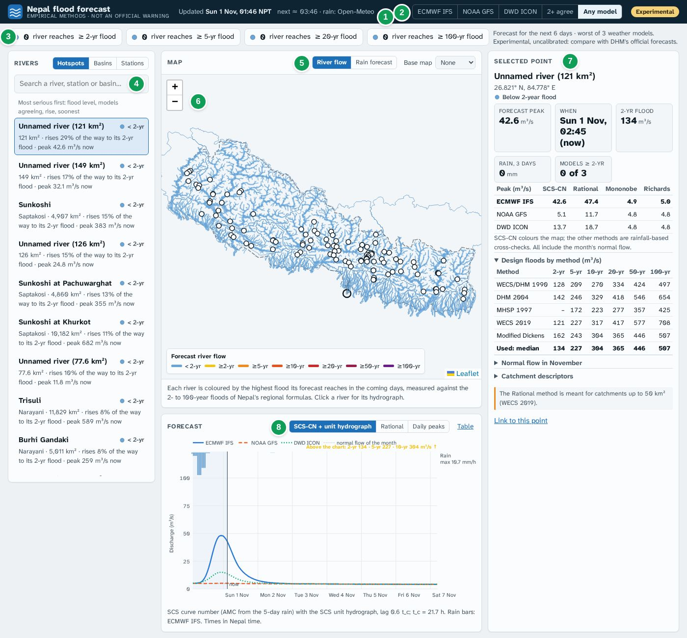

| | Part | What it is for |
|---|---|---|
| **1** | Update line | When this forecast was made, when the next one is due, and where the rain came from (normally *Open-Meteo*) |
| **2** | View buttons | Which weather model the whole page shows: one of the three, **2+ agree** or **Any model** ([section 4](#4-the-top-bar-update-time-and-the-five-views)) |
| **3** | Summary chips | How many river reaches reach the 2-, 5-, 20- and 100-year flood in the chosen view |
| **4** | Rivers list | The most serious rivers first, or the big river systems, or the DHM stations, or a search ([section 7](#7-the-rivers-list-hotspots-basins-stations-search)) |
| **5** | Map layer | **River flow** (rivers coloured by flood level) or **Rain forecast** (rain on a grid), and the base map |
| **6** | Map | Every river of Nepal draining at least 20 km² (about 4,200 reaches) and the 112 DHM stations (white circles) |
| **7** | Selected point | Everything about the river you clicked: peak, timing, flood levels, every method's numbers ([section 8](#8-selected-point-everything-shown-when-you-click-a-river)) |
| **8** | Forecast chart | The forecast flow of that river hour by hour, with its flood levels ([section 10](#10-the-forecast-chart-hydrograph)) |

When the page opens, it selects the first river of the Hotspots list for you.

## 2. A five-minute routine

1. **Check the update line (1).** It should say *Updated* within the last 2 to 3 hours.
   A red **Late** label means the last update is more than 6 hours old. If the line
   names a backup source instead of Open-Meteo, only one weather model is available.
2. **Read the chips (3).** All zeros (as in the real screenshot) means no river reaches
   even its 2-year flood in the coming days, in the chosen view.
3. **Switch between "Any model" and "2+ agree" (2).** *Any model* is the worst case:
   the page opens on it. *2+ agree* shows only what at least two of the three models say.
   A river coloured in both is a stronger signal than a river coloured in *Any model* only.
4. **Open the Hotspots list (4)** and click the first rivers. For each, look at
   **when** the peak comes, **how many models** reach that level, and the **chart**:
   do the three model lines agree, and is the rain that causes the peak still days away?
5. **Open the rain map (5)** and press ▶ to see where and when the rain falls.
6. **Compare with official sources** before acting on anything.

## 3. What a "2-year flood" means

Every river point on the page has six **flood levels**, in m³/s (cubic metres of water
per second): the **2-, 5-, 10-, 20-, 50- and 100-year floods**.

* A **2-year flood** is a flow that the river reaches or exceeds, on average, in one year
  out of two (a 50% chance in any year). It is a high-water mark the river reaches often:
  the banks are full and low fields may get wet, but it is not a disaster.
* A **5-year flood** has a 20% chance in any year, a **20-year flood** 5%, and a
  **100-year flood** 1%. These are rare, damaging floods.
* It is a probability, not a timetable. Two "100-year floods" can come in consecutive years.

These levels are not measured at each river: they come from **Nepal's regional flood
formulas** (WECS/DHM 1990, DHM 2004, MHSP 1997, WECS 2019 and Modified Dickens), which
estimate floods from the catchment area and elevation. The page uses the **median** of the
five formulas and shows all of them for every point ([section 8](#design-floods-by-method)).

The page always shows a level with a **colour, a shape and words**, so it can be read
without colour vision too:

| Shape | Colour | Words |
|---|---|---|
| ● circle | blue | *Below 2-year flood* / *< 2-yr* |
| ▲ triangle | yellow, orange | *≥ 2-year flood*, *≥ 5-year flood* |
| ◆ diamond | red-orange, red | *≥ 10-year flood*, *≥ 20-year flood* |
| octagon | dark red, purple | *≥ 50-year flood*, *≥ 100-year flood* |

## 4. The top bar: update time and the five views

The forecast is remade **every 2 hours** on GitHub's servers. Each update downloads the
latest hourly rain forecasts of three global weather models from Open-Meteo:

* **ECMWF IFS**, the European Centre's model
* **NOAA GFS**, the US model
* **DWD ICON**, the German model

They often disagree, especially on *where* heavy rain falls, so the page lets you choose
how to look at them:

| Button | What the page shows | When to use it |
|---|---|---|
| **ECMWF IFS**, **NOAA GFS**, **DWD ICON** | That model alone | To see one model's story; its chart line is drawn bold, the others faint |
| **2+ agree** | For each river, the highest level that **at least two** models reach | The more confident picture: fewer false alarms |
| **Any model** *(default)* | For each river, the highest level that **any** model reaches | The worst case: nothing is missed, but more false alarms |

The made-up storm below shows the five views of the same forecast side by side. In it,
ECMWF puts its heaviest rain around Pokhara, GFS further east and ICON is weaker. **Any
model** is the union of all three (983 reaches ≥ 2-yr), **2+ agree** keeps only where two
models overlap (355 reaches):

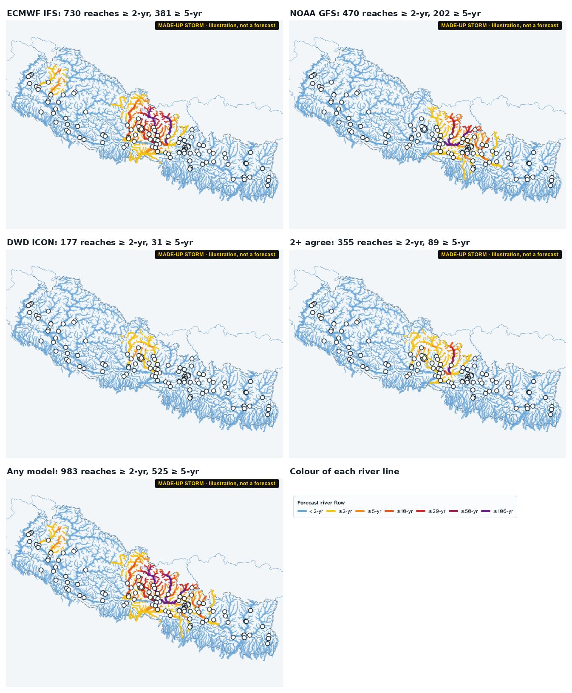

The line under the chips says which view you are in ("worst of 3 weather models",
"what at least 2 of 3 weather models agree on", or the model's name) and how many days
ahead the forecast goes (6 to 7).

## 5. The map: river flow

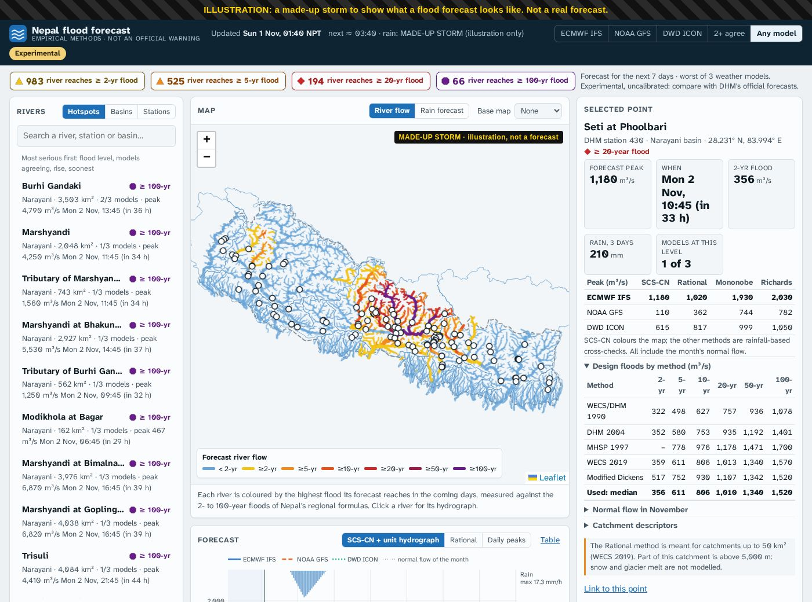

* **Colour**: the highest flood level the river's forecast reaches **at any time from
  now to the end of the forecast**, in the chosen view. Blue = stays below its 2-year flood.
  The colour does not say *when*: click the river for that.
* **Line width**: bigger rivers (larger drainage area) are drawn thicker.
* **White circles**: the 112 DHM hydrometric stations. **Dashed grey line**: Nepal's border.
  **Thin blue outlines**: the 75 river systems that leave Nepal.
* **Hover** over a river for its name, drainage area, forecast peak, level and 2-year flood.
* **Click** a river or station to select it. A ring marks the point and a faint grey halo
  marks every river upstream of it, that is, the catchment whose rain feeds it.

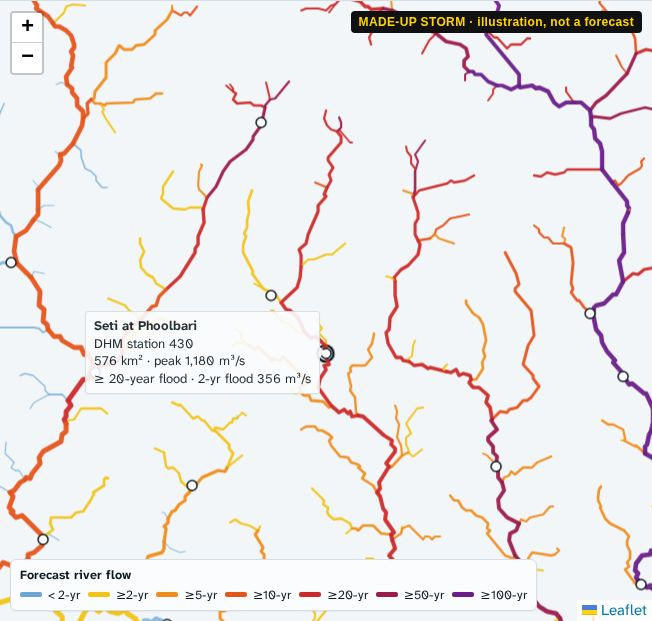

The tooltip above reads: *Seti at Phoolbari, DHM station 430, 576 km², peak 1,180 m³/s,
≥ 20-year flood, 2-year flood 356 m³/s*. In words: in the worst model, this river is
forecast to carry more than three times its 2-year flood.

**Base map.** The map opens with **None**, plain rivers on a light background, which is the
clearest for reading flood colours. Choose **Terrain**, **Streets** or **Satellite** to see
villages, roads and hills underneath; your browser remembers the choice.

**Zoom** with the + and − buttons, the mouse wheel or two fingers. Even the smallest
coloured line is a real river of at least 20 km².

## 6. The map: rain forecast

Press **Rain forecast** above the map. The rain is drawn as squares of 0.25°
(about 25 km): one square per point of the weather-model grid.

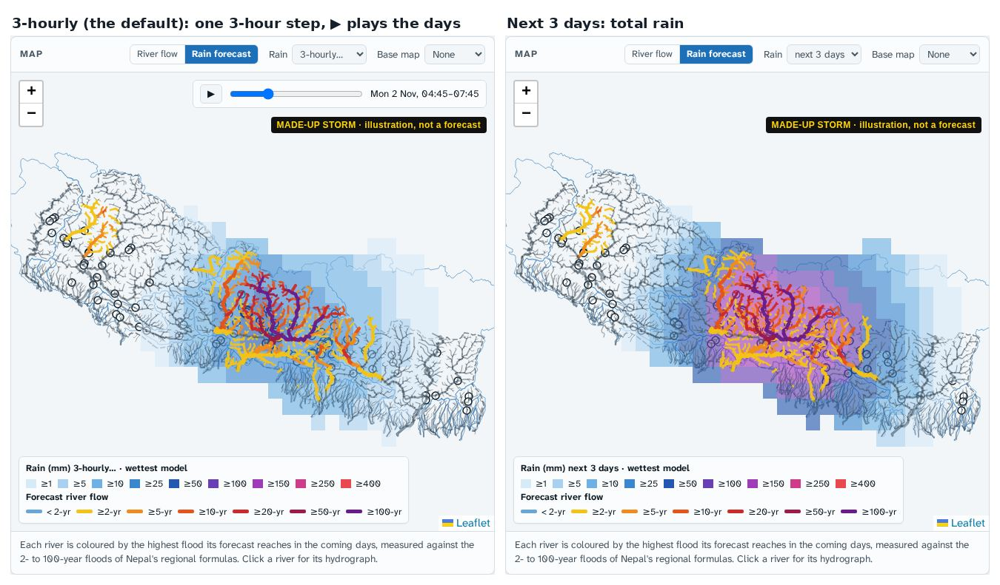

* The layer opens on **3-hourly**: the rain of one 3-hour window, starting with the
  current one. The time is shown next to the slider in the top-right corner. Press **▶**
  to play through the days (it loops), **❚❚** to pause, or drag the slider. The slider
  starts 24 hours in the past, so you can also replay the rain that has already fallen.
* The **Rain** menu also offers totals: **next 24 h**, **next 3 days**, **next 7 days**
  and **past 24 h**.
* In **Any model** and **2+ agree** the squares show the **wettest model** in each square;
  pick a single model to see its own rain.
* Rivers below their 2-year flood turn grey so the rain stands out; rivers at a flood level
  keep their colour, so you can see which rain is causing which flood.
* Hover over a square for its exact amount in mm.

What to look for: rain over the **upper catchment** of a river reaches the plains hours
to days later. Heavy rain in the hills today can mean a flood downstream tomorrow.

## 7. The Rivers list: Hotspots, Basins, Stations, search

### Hotspots

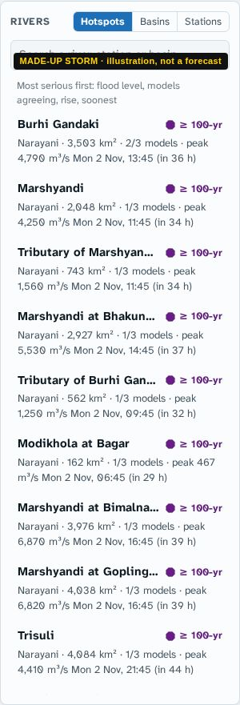

The most serious rivers come first, ranked by:

1. the **flood level** reached (100-year before 50-year …),
2. then **how many models** reach it,
3. then **how far the river rises** towards its 2-year flood,
4. then the **soonest** peak.

Each river appears once (at its most serious point); stations and your own points are
listed separately. The list shows up to 60 lines and stops early when the rest are quiet.
On a dry day the caption says *"No river is forecast to rise noticeably"*.

How to read a line:

| Example | Meaning |
|---|---|
| **Burhi Gandaki** · ≥ 100-yr Narayani · 3,503 km² · 2/3 models · peak 4,790 m³/s Mon 2 Nov, 13:45 (in 36 h) | Basin Narayani, drainage area 3,503 km². Two of the three models reach the 100-year flood here. The highest flow, 4,790 m³/s, is forecast for Monday 13:45, 36 hours from now |
| **Unnamed river (121 km²)** · < 2-yr 121 km² · rises 29% of the way to its 2-yr flood · peak 42.6 m³/s now | Below its 2-year flood. Its flow is 29% of the way from its normal flow (for the month) to its 2-year flood, and the highest value is *now*, so it is already falling (see [section 11](#11-reading-a-quiet-day)) |
| … · no rise forecast, 18.0 m³/s *(example)* | The forecast stays within about 5% of the normal flow of the month |

### Basins

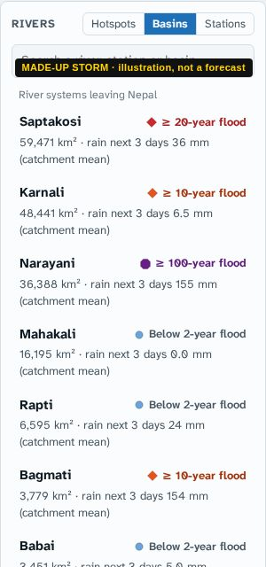

The 75 river systems that leave Nepal (Saptakosi, Karnali, Narayani …), largest first.
The badge is the highest level reached anywhere in that basin in the chosen view; the
line gives the **mean rain over the whole basin for the next 3 days** (the wettest model
in the combined views). Clicking a basin selects its outlet, where it leaves Nepal.

### Stations

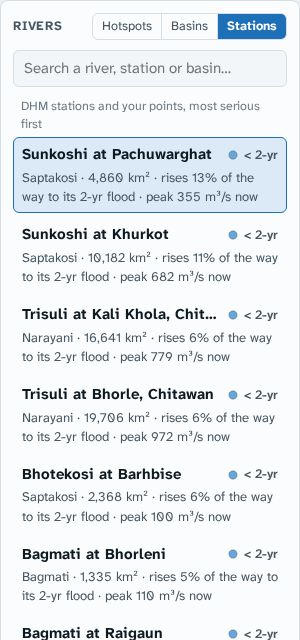

The 112 DHM hydrometric stations (and any points added by the operator), ranked like the
hotspots. Use it to check a forecast against the water levels DHM publishes.

### Search

Type part of a river, station or basin name, or a DHM station number (e.g. *DHM 430*).
Only named points appear in the results, largest first.

## 8. Selected point: everything shown when you click a river

*Made-up storm, Any model.*

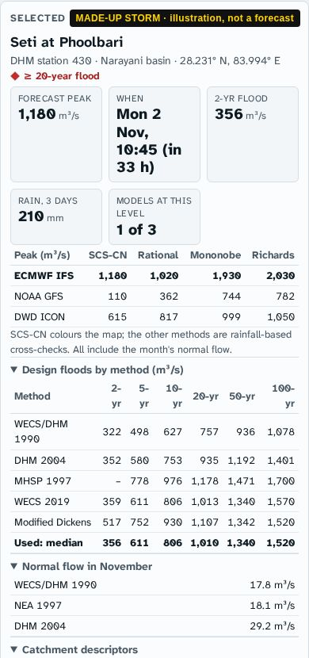

### The heading

* **Name**: the river or station name. Smaller streams without a name in the river data
  are called *"Tributary of …"* (with the named river they join) or *"Unnamed river"*,
  followed by their drainage area.
* **DHM station number** (for stations), the **basin**, and the coordinates.
* The **badge** gives the flood level in the chosen view.

### The five boxes

| Box | Meaning | In the example |
|---|---|---|
| **Forecast peak** | The highest flow forecast **from now to the end of the forecast**, in m³/s, by the main method (SCS-CN) for the model the view picked | 1,180 m³/s |
| **When** | The time of that peak in Nepal time, and how far ahead. *now* means the flow is highest right now and falling. *No rise forecast* means it never goes 5% above its normal flow | Mon 2 Nov, 10:45, in 33 h |
| **2-yr flood** | This point's 2-year flood (median of the formulas). Compare it with the peak | 356 m³/s: the peak is 3.3 times larger |
| **Rain, 3 days** | Mean rain over the catchment in the next 72 hours (the wettest model in the combined views) | 210 mm |
| **Models at this level**, or **Models ≥ 2-yr** | How many of the three models reach the level of the badge. When the river is below its 2-year flood, how many reach the 2-year flood at all | 1 of 3: only ECMWF |

### Peaks by model and method

A small table: for each weather model, the forecast peak by each of the four
**rainfall-based methods**:

* **SCS-CN** (SCS curve number with the SCS unit hydrograph) is the **main method**. It
  colours the map and draws the chart. It follows the storm hour by hour, takes into
  account how wet the ground is from the last 5 days of rain, and keeps the water of
  earlier rain draining.
* **Rational**: flow = runoff coefficient × rain intensity over the catchment's response
  time × area. Simple, meant for small catchments (up to 50 km²).
* **Mononobe** and **Richards**: one peak per day from that day's total rain. They are
  traditional design methods, shown as cross-checks.

The **bold row** is the model the current view uses. All values include the normal flow of
the month. When the four methods agree, the forecast is less sensitive to the choice of
formula; when they differ a lot (as here: 1,180 to 2,030 m³/s for ECMWF), treat the peak as
a range, not one number.

### Design floods by method

The 2- to 100-year floods of each regional formula for this point, and **Used: median**,
which gives the flood lines on the map and chart. The **Chart | Table** switch at the top
right shows them as a chart (the default) or as a table; the page remembers your choice in
this browser.

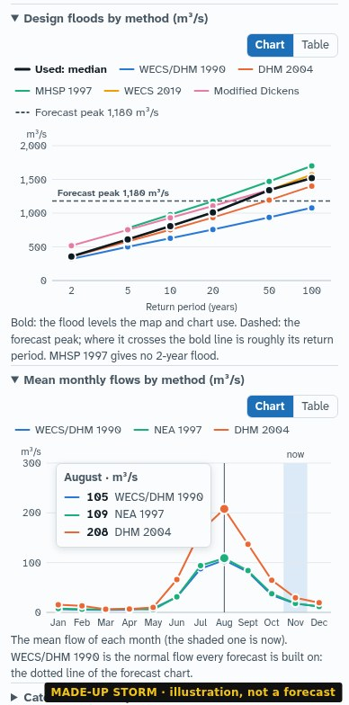

* **The chart** has one line per formula: the return period along the bottom (2 to 100
  years), the flow up the side. The **bold black line** is the median, the flood levels in
  use. The **dashed line** is the forecast peak: where it crosses the bold line is roughly
  the return period of the forecast flood. Here the peak of 1,180 m³/s crosses between the
  20-year (1,010) and the 50-year flood (1,340), hence the badge *≥ 20-year flood*.
* **Point at the chart** (tap it on a phone) to read every formula at the nearest return
  period. With a keyboard, Tab to the chart and use the arrow keys.
* **Click a name in the legend** to hide or show its line. The scale adjusts to the lines
  left, which helps when one formula is far above the others. *n/a* in the legend means the
  formula gives no value for this point.
* **The table** has the same numbers. A dash (–) means the formula does not give that
  return period here (MHSP 1997 has no 2-year flood; WECS 2019 is not used below 12 km²);
  on the chart, that line starts later or is missing.

The spread between the lines shows how uncertain the flood levels themselves are: for Seti
at Phoolbari the 2-year flood is 322 to 517 m³/s depending on the formula.

### Mean monthly flows, catchment descriptors, warnings

* **Mean monthly flows by method**: the mean flow of every month of the year by three
  formulas (WECS/DHM 1990, NEA 1997 and DHM 2004), as a chart or a table like the design
  floods. The shaded month (the bold row in the table) is the current one. WECS/DHM 1990 is
  the base on which every forecast is built, the dotted line in the forecast chart. The
  formulas can differ several-fold: DHM 2004 gives about twice as much as the other two for
  catchments with a mean elevation of 1,500 to 3,000 m, like Seti at Phoolbari (208 against
  105 m³/s in August), and about a fifth as much in the low Terai.

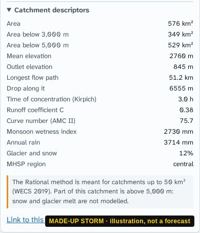

* **Catchment descriptors**: the facts about the catchment that the formulas use:

| Descriptor | What it is | Why it matters |
|---|---|---|
| Area, area below 3,000 m and 5,000 m | Land draining to this point, in total and below those heights | The flood formulas are based on area: WECS/DHM 1990 and DHM 2004 count only the land below 3,000 m, Modified Dickens the snow area above 5,000 m |
| Mean and outlet elevation | Average height of the catchment, height of the point | Where the water comes from |
| Longest flow path, drop along it | Length of the longest route water travels to this point, and how far it falls | Give the time of concentration |
| Time of concentration (Kirpich) | Hours for rain from the farthest part to arrive | Short (≤ 3 h): a flashy river that floods within hours of heavy rain. Long (a day or more): floods build slowly and last |
| Runoff coefficient C, curve number | How much of the rain runs off, from land cover (ESA WorldCover): towns, ice and fields give higher values than forest | Higher = more flood per mm of rain |
| Monsoon wetness index, annual rain | Mean June-September and annual rain over the catchment (ERA5 2019-2023) | Used by the normal-flow formulas; too wet over the hills ([section 13](#13-what-the-forecast-cannot-tell-you)) |
| Glacier and snow | Share of the catchment under ice and snow | Melt is not modelled |
| MHSP region | Western, central or eastern Nepal | Chooses the MHSP 1997 coefficients |

* **Warnings** (orange box) appear when a method is outside its range: the Rational method
  above 50 km², a catchment partly above 5,000 m (snow and glacier melt are missing), a time
  of concentration over 24 h (daily methods do not apply), or a very large river (over
  5,000 km², whose floods come from far upstream over days).
* **Link to this point**: a web address that opens the page on this river; see [section 12](#12-on-a-phone-and-sharing-a-river).

## 9. How many numbers become one colour

Behind every river there are 3 weather models × 4 rainfall methods × 6 return periods ×
5 flood formulas. The page reduces them in fixed steps:

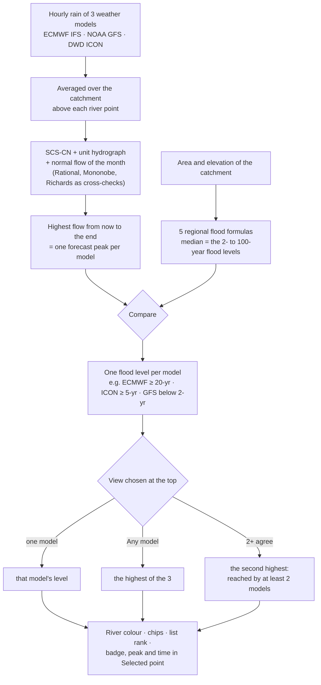

**Worked example**: Seti at Phoolbari in the made-up storm. Its flood levels (median row)
are 356 (2-yr), 611 (5-yr), 806 (10-yr), 1,010 (20-yr), 1,340 (50-yr) and 1,520 m³/s
(100-yr). The three models give these SCS-CN peaks:

| Model | Peak | Highest level reached |
|---|---|---|
| ECMWF IFS | 1,180 m³/s | ≥ 20-year (above 1,010, below 1,340) |
| DWD ICON | 615 m³/s | ≥ 5-year (just above 611) |
| NOAA GFS | 110 m³/s | below the 2-year flood |

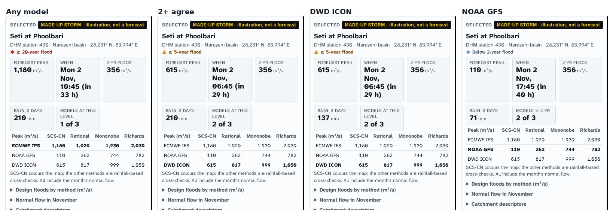

* **Any model** takes the highest, ECMWF: ◆ *≥ 20-year flood*, peak 1,180 m³/s on Monday
  10:45, **1 of 3** models at this level.
* **2+ agree** takes the second highest, ICON: ▲ *≥ 5-year flood*, peak 615 m³/s on Monday
  06:45, **2 of 3** models (ECMWF and ICON both reach at least the 5-year flood).
* **DWD ICON** alone gives the same level and peak, but its own 3-day rain (137 mm instead
  of the wettest model's 210 mm).
* **NOAA GFS** alone: *below 2-year flood*, peak 110 m³/s. The box reads *Models ≥ 2-yr:
  2 of 3*, a reminder that the other two models do flood this river.

How to read it: *"A flood is likely here on Monday morning. Two models say at least a
5-year flood, one says a 20-year flood, one sees almost nothing. Watch the next updates."*
When two models agree on the level of a flood, the forecast is stronger than when only
one model shows it.

When two models reach the same level, the view takes the one with the larger rise. The bold row of the peaks table always shows which model the view is using.

## 10. The forecast chart (hydrograph)

*Made-up storm, Any model, mouse over the ECMWF peak.*

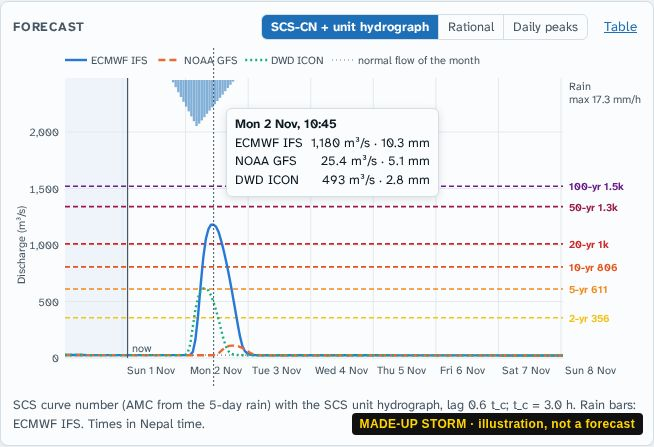

| Element | Meaning |
|---|---|
| Horizontal axis | Time in Nepal time, from 24 hours ago (shaded) to the end of the forecast |
| **now** line | The present. Left of it: what the models' rain did; right: the forecast |
| Coloured lines | Flow by model: ECMWF solid blue, GFS dashed orange, ICON dotted green |
| Dotted grey line | The normal flow of the month, the base under every forecast |
| Blue bars hanging from the top | Hourly catchment rain (of ECMWF in the combined views, of the chosen model otherwise); the largest hourly amount is written at the right ("max 17.3 mm/h") |
| Dashed horizontal lines | The flood levels: 2-yr yellow up to 100-yr purple, labelled at the right |
| "Above the chart: …" | Flood levels too high to fit: the forecast stays well below them |
| Mouse over | A vertical line and a box with the time, each model's flow and its rain in that hour |

What to read from it:

* **Which flood lines a model line crosses**, and **for how long**.
* **Timing.** The gap between the rain bars and the peak is the catchment's response time:
  about 6 hours for this 576 km² river (time of concentration 3 h). Big rivers respond
  over a day or more.
* **Agreement.** Here ECMWF rises to 1,180 m³/s, ICON peaks earlier at 615 and GFS hardly
  moves: the models disagree on how much rain falls *on this catchment*.
* **Rising or falling.** If the highest point is at the *now* line, the river is past its
  peak.

The buttons above the chart switch the method, and **Table** lists the numbers:

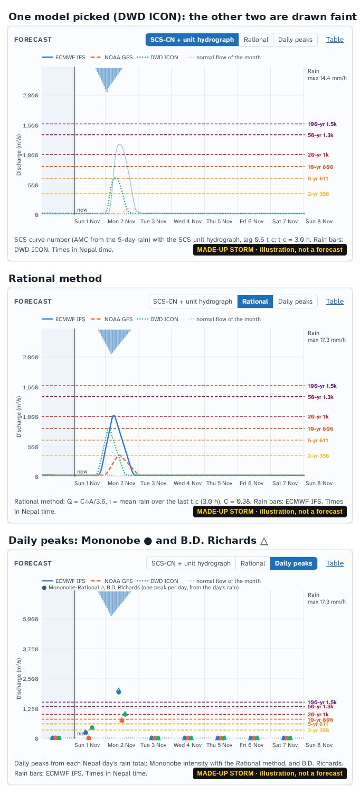

* **Picking one model** at the top draws its line bold and the other two faint, and shows
  its own rain bars.
* **Rational** responds to rain at once and drops as soon as it stops: a cross-check,
  meant for small catchments.
* **Daily peaks** shows one point per day and model: ● Mononobe-Rational and △ B.D. Richards,
  computed from each day's rain total.
* **Table** gives the values every 3 hours: flow and rain (over those 3 hours) for each
  model, and the normal flow, for copying into a report or a spreadsheet.

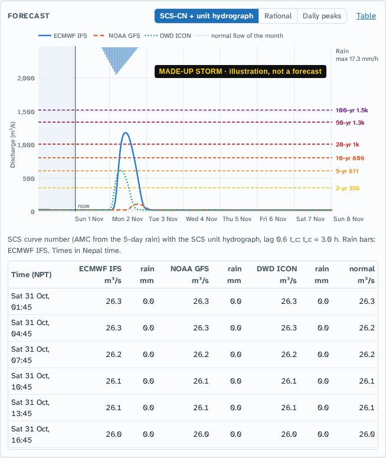

## 11. Reading a quiet day

*Real, 1 November 2026: Sunkoshi at Pachuwarghat (DHM station 630).*

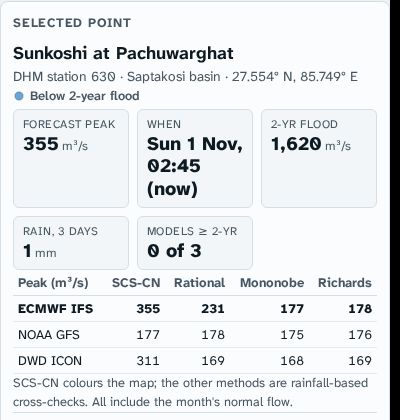
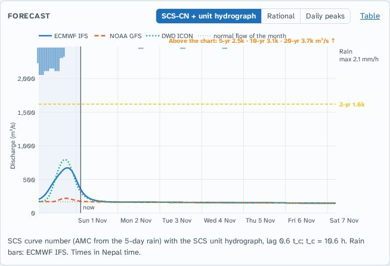

* **When: … (now).** The highest flow of the forecast is right now. The chart shows why: a
  little rain fell in the last day (the bars in the shaded past), the river rose, and from
  now on it falls back towards its normal flow.
* **Forecast peak 355 m³/s vs 2-yr flood 1,620 m³/s**: about a fifth of the 2-year flood.
  *Models ≥ 2-yr: 0 of 3*, *Rain, 3 days: 1 mm*. Nothing to watch.
* The chart shows only the 2-year line; the higher ones are listed as *"Above the chart"*.
* In the peaks table the daily methods (Mononobe 177, Richards 178) are lower than SCS-CN
  (355): they only see each future day's rain, which is almost zero, while SCS-CN still
  carries the water of the past rain draining out.
* In the Hotspots list the same river reads *"rises 13% of the way to its 2-yr flood ·
  peak 355 m³/s now"*. *Rises* is measured from the normal flow of the month, not from the
  present flow: the river is 13% of the way from normal to its 2-year flood, and falling.

## 12. On a phone, and sharing a river

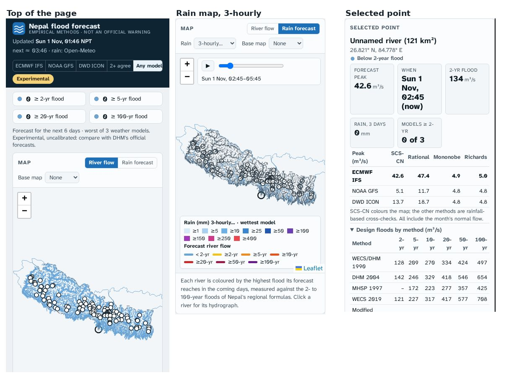

On a narrow screen the parts are stacked: the summary and map first, then the chart, the
selected point and the list. Everything works the same; the view buttons scroll sideways if
they do not fit.

**Sharing.** Click **Link to this point**, or simply copy the address from the browser after
selecting a river: it ends in `#t=2048&m=any` (point number and view). Whoever opens it gets the
same river in the same view, with the newest forecast.

## 13. What the forecast cannot tell you

* **It is not calibrated.** The formulas have not been tuned against floods measured at these
  rivers. Use the levels to compare rivers and days, not as exact predictions.
* **Rain only.** Snow and glacier melt, glacial lake outbursts (GLOFs), landslide dams,
  dam releases and embankment breaches are not in it.
* **Weather-model rain is coarse** (9 to 25 km). It misses small, intense thunderstorms,
  which cause flash floods in the Chure and small hill streams. A blue small river is not a
  promise that it will stay calm.
* **Big Himalayan rivers** (Koshi, Narayani, Karnali) get their floods from far upstream
  over days, partly from snowmelt; the empirical methods are rough there.
* **The normal flow runs high in the hills** (the climate data used is too wet there), so
  the base under the forecast is generous in the hills.
* **The forecast is only as good as the last update.** Check the update time, and expect
  rain forecasts beyond 3 days to change.

## 14. Questions people ask

**Every river is blue. Is the page working?**
Yes, if the update time is recent. In the dry season most days are like this. The Hotspots
list still shows the rivers rising the most.

**Why does a river show a flood in "Any model" but not in "2+ agree"?**
Only one model brings enough rain to that catchment. Look at that river's chart: if the other
two models also rise but stay just below the line, the signal is stronger than if they stay flat.

**Why do the models disagree so much?**
Heavy rain in the mountains is hard to forecast; a shift of 30 km moves the rain into
another valley. Disagreement is information: it tells you the forecast is uncertain.

**The peak says "now" but no rain is forecast. Why is the flow above normal?**
Water from rain that has already fallen is still draining. The flow is falling back to normal.

**Why is the forecast peak at a station different from what DHM measures?**
The page estimates flows with formulas from rain forecasts; DHM measures water levels.
Differences of a factor of two are possible. Trust the measurements and DHM's official forecast.

**How far ahead can I trust it?**
The first 1 to 2 days are the most reliable. Beyond 3 days, treat a flood signal as an
early heads-up and watch whether it persists through the next updates.

**Why do some rivers have no name?**
Names come from the DHM station list: a river is named along its main stem wherever a DHM
station names it. Other streams are named after the named river they join ("Tributary of …"),
or called "Unnamed river" with their drainage area.

## 15. Glossary

| Term | Meaning |
|---|---|
| **m³/s** | Cubic metres per second: the flow of a river. 1 m³/s is 1,000 litres every second |
| **Discharge, flow** | How much water passes a point of the river per second |
| **Catchment, drainage area** | All the land whose rain drains to a point of the river, in km² |
| **Return period, T-year flood** | A flow reached or exceeded on average once every T years (a 1/T chance in any year) |
| **Flood level** | Here: the 2- to 100-year floods of a point, the median of five regional formulas |
| **Normal flow** | The mean flow of the month, from regional formulas |
| **Hydrograph** | A chart of flow against time |
| **Time of concentration (t_c)** | The time for rain from the farthest part of the catchment to reach the point |
| **SCS-CN** | The US Soil Conservation Service curve-number method: how much rain runs off, depending on land cover and how wet the ground is |
| **Unit hydrograph** | How a catchment spreads a burst of runoff out in time |
| **Reach** | A stretch of river between two junctions; the page forecasts each reach at its downstream end |
| **NPT** | Nepal time, UTC + 5:45. All times on the page are Nepal time |
| **ECMWF, GFS, ICON** | The European, US and German global weather models |
| **DHM** | The Department of Hydrology and Meteorology of Nepal, the official source of flood forecasts and warnings |

---

*Screenshots: the real ones are the forecast of 1 November 2026, 01:46 NPT. The made-up storm
puts up to 260 mm of rain in a day on central Nepal, differently for each model, and was run
through the same code locally. It was never published as a forecast.*
